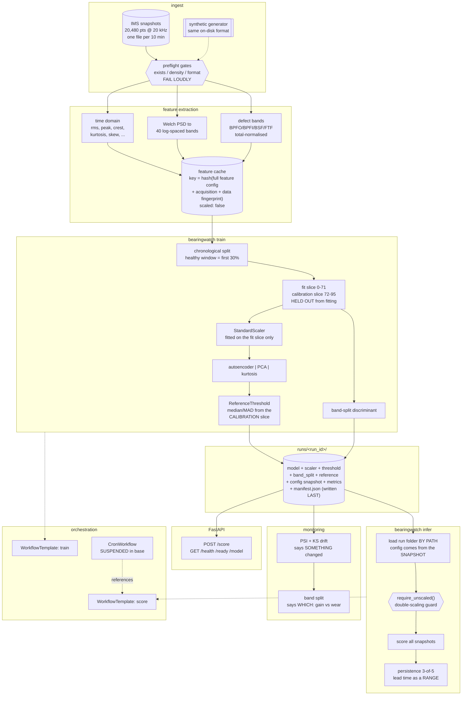

# Architecture

## The pipeline



Plain text, for anywhere mermaid does not render:

```
ingest ──> features ──> train ──> run folder ──┬──> infer ──> detect
  │           │           │          (one dir)  ├──> serve (FastAPI)
  │           │           │                     └──> monitor (drift + band split)
  │           │           │
  │           │           └── fits on healthy window ONLY; threshold calibrated
  │           │               on a HELD-OUT slice of it
  │           └── cached under a content hash of the FULL feature config
  └── preflight gates: exists / density / format — fail, never warn
```

---

## Five properties the design is built around

Each is a bug class that does not announce itself. All five produce plausible
numbers rather than errors, which is what makes them expensive.

### 1. Run-folder discipline

Everything a training run produces goes into **one directory**, and inference
loads that directory **by path**. Never a loose model file.

```
runs/20260828T201454Z-ab2c4e1c/
  manifest.json          provenance; WRITTEN LAST
  config.snapshot.yaml   the full config as resolved for this run
  model.pt               (or model_pca.npz / model_kurtosis.json)
  model_meta.json        feature names, in order, + train metrics
  scaler.npz             standardiser, as plain arrays (not a pickle)
  threshold.json         declared-reference median/MAD
  band_split.json        gain-vs-mechanical discriminant state
  reference.parquet      healthy-window features, UNSCALED, for drift
  metrics.json
  inference/<infer_id>/  scores.parquet + metrics.json per scoring pass
```

The alternative — `models/best.pt` beside `scaler.pkl`, each overwritten by
whichever run finished last — fails specifically: the files are individually
valid, so pairing a model from one run with a scaler from another raises nothing.
If the widths happen to match you get numbers, and there is no way to tell from
the output that the pair does not belong together.

`manifest.json` is written last, so a folder without one is a run that crashed,
and `RunFolder.open()` refuses it. Run folders are never overwritten:
`RunFolder.create` on an existing id raises.

The scaler is stored as `.npz` rather than pickle. A pickled sklearn estimator is
tied to the library version that wrote it and executes code on load; mean and
scale vectors are the entire content of a `StandardScaler`.

### 2. Train / inference separation

`bearingwatch train` and `bearingwatch infer` are independent entry points
sharing **no process state**. They communicate only through a run folder on disk.

The test of the separation, in `tests/test_cli_end_to_end.py`: `infer` works in a
process that has never seen `train`, given only a path. This is what makes the
two Argo `WorkflowTemplate`s a description of the real pipeline rather than a
wrapper around a monolith — the steps can be scheduled apart, retried apart, and
given different resources.

### 3. Feature-cache key correctness

The cache key is a content hash over the **entire** feature config subtree, plus
the acquisition parameters that change the numbers (sample rate, record length,
channel count), plus a fingerprint of the input files.

The failure mode this prevents: the key is derived from a data path and a version
integer somebody remembers to bump. A feature parameter changes, the key does
not, and the next run reads features computed under the **old** parameters,
trains on them, and reports numbers. Nothing raises. The only tell is that
results stop responding to parameter changes — which reads as "that parameter
does not matter".

`tests/test_cache_key.py` perturbs each of 27 parameters and asserts the key
moves, then asserts end-to-end that a moved key forces a recompute.

The one thing a config hash cannot see is a **code** change to the extractors.
That is what `features.schema_version` is for: a manual field, documented as
manual.

### 4. Double-scaling guard

Every feature table carries a `scaled: bool` in its parquet metadata. Tables
written to the cache are always unscaled. `apply_scaler` refuses a table already
marked scaled, and the scoring path calls `require_unscaled` before transforming.

A **missing** flag is an error, not an assumed `False`. Guessing is exactly what
causes the problem.

Measured on this repo's own features: double-scaling inflates reconstruction
error by about **seven orders of magnitude** while raising nothing — no shape
error, no NaN, no warning. The direction depends on the feature means; for a
zero-centred feature set the same mistake deflates the score instead and the
detector goes quiet. Either way the number is wrong and nothing says so.

### 5. Preflight gates

Before a run: does the data exist, at the density claimed, in the format
expected. All three, and the middle one is the one people skip.

* **exists** — the directory holds snapshot files
* **density** — enough files, spaced the way the config says. A directory with a
  tenth of the expected files, or an "every 10 minutes" run with six-hour gaps,
  still trains and still produces a plausible number. Nothing downstream can
  detect it.
* **format** — exactly 20,480 points and the expected channel count, sampled
  across the run (a download that failed part way through has a perfectly good
  first file), and re-checked on **every single read** in the parser.

A failed gate **raises**. It does not warn. A warning in a scheduled job is a log
line nobody reads, and the run still writes a model.

---

## The detection design

### The reference period

To turn a score into a verdict you need a median and a MAD. The tempting choice
is to compute them from the series being scored. For a monotone ramp
`x_i = a + b·i`, the MAD converges to a quarter of the total range while the
maximum deviation is half of it, so

```
max|z| → (range/2) / (1.4826 · range/4) = 2/1.4826 ≈ 1.349
```

and the slope **cancels entirely**. A score that ramps by 2× and one that ramps by
1000× give the same max|z| ≈ 1.35. Against any sensible threshold the detector
never fires — not "fires late", never, at any magnitude — while still firing
correctly on spikes, so it passes every spike test written for it.

Bearing degradation is a ramp. The companion project **`tsad-harness`** derives
this in general; this repo is where it is paid for.

The precondition matters operationally: the pinning is exact when the scored
window is *dominated by the ramp*. A window still half stationary has its MAD set
by the stationary half and can fire. That is worse, not better — a self-
referencing detector fires early while the window straddles the healthy period,
then goes silent as the window slides fully into the degradation, exactly when
the bearing is worst.

So the reference comes from a period **declared stationary in advance**.
`reference: self` remains implemented purely so the failure can be demonstrated
by running it (`tests/test_reference_threshold.py`).

### Held-out calibration

Even with a correct reference period, calibrating on the snapshots the model was
*fitted* on measures in-sample residuals, which are optimistically low for any
reconstruction model. Measured here: PCA calibrated in-sample fired 29 snapshots
before degradation began, a 22.7% false-positive rate on genuinely healthy data.
The last 25% of the healthy window is held out from fitting and used only to
calibrate.

### Lead time as a range

For a ramp there is no moment when the signal changed — the apparent onset is
wherever the ramp crosses a threshold set by whatever window was declared
healthy. `sweep_lead_time` sweeps the baseline fraction and reports the spread,
so the arbitrariness is visible in the output. On the synthetic run the spread is
**18.2 hours**. If the range is wide, that *is* the finding.

---

## Serving

| Endpoint | Purpose |
|---|---|
| `GET /health` | liveness — the process is up. Deliberately does not touch the model. |
| `GET /ready` | readiness — a model is loaded and can score |
| `GET /model` | which run is loaded, and the exact feature order `/score` expects |
| `POST /score` | score a raw snapshot or a batch of feature vectors |
| `POST /reload` | swap run folders without restarting (local/demo convenience) |

Health and readiness are separate because they drive different actions. Liveness
restarts a wedged process; readiness gates traffic. A pod whose model failed to
load is alive and must not receive traffic — and a liveness probe pointed at the
model would restart it instead, turning a diagnosable problem into a crash loop
with no diagnostic.

The model loads once at startup and its `run_id` is in **every** response. "Which
model was serving on the 14th" is the first question asked about any surprising
result; answering it from a container image tag is guesswork.

---

## Orchestration

`deploy/argo/` holds two `WorkflowTemplate`s (train, score) and one
`CronWorkflow`. `deploy/k8s/` holds a kustomize base, an `enable-cron` component,
and dev/prod overlays.

**The CronWorkflow ships suspended in the base.** A cron that is active on apply
starts running the moment it lands in any cluster it is synced to — including a
fresh environment where the data mount is wrong. It does not error; it runs, and
writes results that look real. Enabling it is a per-environment decision made by
including one component, which shows up in a diff as "this environment now runs a
schedule".

**Templates are referenced, never inlined.** Inlining a workflow body into the
thing that schedules it means the scheduled version and the manually-run version
drift apart, and the one that drifts is always the one nobody looks at.

**`run-id` has no default.** A scheduled job that resolves "the latest model" at
runtime changes what it does without anyone deploying anything, and the change is
invisible until the results move. Changing the served model is a commit.

Prod pins the image by **digest**, not tag: a tag is a mutable pointer, and a
repushed tag changes running code with nothing in git to show for it.

---

## Artifact storage

`store/artifact_store.py` abstracts over a local filesystem backend and an S3
backend, selected by URI (`file://runs`, `s3://bucket/prefix`). boto3 is a
guarded import, so the pipeline, tests and container all run with no AWS account
and no network.

The S3 backend uploads `manifest.json` **last**, mirroring the on-disk rule, so
"manifest present means the run is complete" holds there too and a partial upload
cannot be mistaken for a finished run.

---

## Optional integrations

All behind guarded imports. The core pipeline runs green without any of them.

| Integration | Behaviour when absent |
|---|---|
| **MLflow** | tracking skipped; the run folder is the source of truth and is complete without it. Transport errors are logged, never fatal — a metadata-service outage must not stop model production. |
| **Evidently** | a built-in PSI + KS implementation always runs. Evidently adds richer HTML for investigation. A monitoring signal that only exists when an optional package imports cleanly will be absent on the day it matters. |
| **boto3** | local filesystem artifact store |
| **torch** | required for the autoencoder only; PCA and kurtosis baselines, and serving a PCA run folder, work without it |
